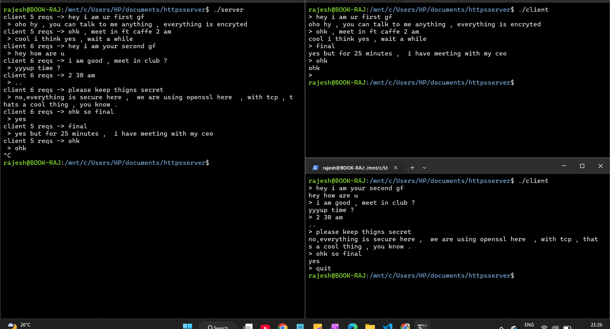

# TLS Client–Server Chat in C

A command-line chat application written in C. The client and server exchange messages over a TCP connection protected by TLS using OpenSSL. The server uses `epoll` to watch for client sockets and prompts for a reply whenever a client sends a message.

## Demo

The screenshot below shows the server and two client sessions exchanging messages:



## Requirements

- GCC or another C compiler
- OpenSSL development headers and libraries
- The OpenSSL command-line tool, to create a local certificate
- Linux or another Unix-like system (the code uses POSIX socket APIs and Linux `epoll`)

## Set up a local certificate

Both programs expect `cert.pem` and `key.pem` in the directory where they are run. Create a self-signed certificate for local testing:

```sh
openssl req -x509 -newkey rsa:2048 -keyout key.pem -out cert.pem \
  -days 365 -nodes -subj "/CN=localhost"
```

The client trusts `cert.pem`. Keep `key.pem` private; never publish it.

## Build

Run these commands from the project directory:

```sh
gcc server.c -o server -lssl -lcrypto
gcc client.c -o client -lssl -lcrypto
```

## Run

Open a terminal and start the server:

```sh
./server
```

In another terminal, start a client:

```sh
./client
```

Type a message at the client prompt and press Enter. The server prints the message and prompts its operator for a reply, which is returned to that client. Start additional client processes to connect more clients. Enter `quit` at a client prompt to exit that client; enter `quit` at the server's reply prompt to close the current client connection. Stop the server with Ctrl+C.

The server listens on port `8080` on all network interfaces. The client connects to `127.0.0.1:8080`, so by default both run on the same machine. To connect from another machine, update the address in `client.c` and allow inbound connections to port `8080` in the server's firewall.

## Message format

Each message is sent over TLS as a four-byte unsigned length in network byte order, followed by the message bytes. Messages are limited to 2047 bytes.

## Limitations and security notes

- The server handles TLS reads and replies synchronously. A slow or idle client can block the server while it waits for a message, and the server operator replies to one client at a time.
- The client trusts the supplied certificate but does not verify that its identity matches the server address. The self-signed certificate setup is for learning and local testing, not production use.
- Use a trusted certificate, hostname verification, and proper certificate and key handling before exposing a service beyond local testing.
